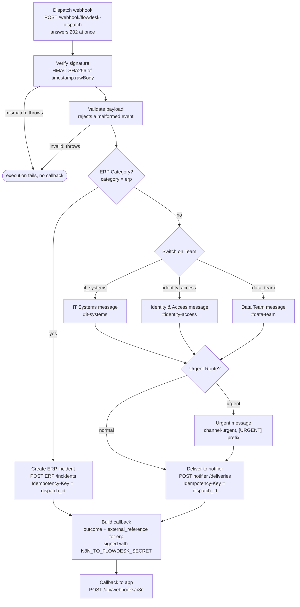
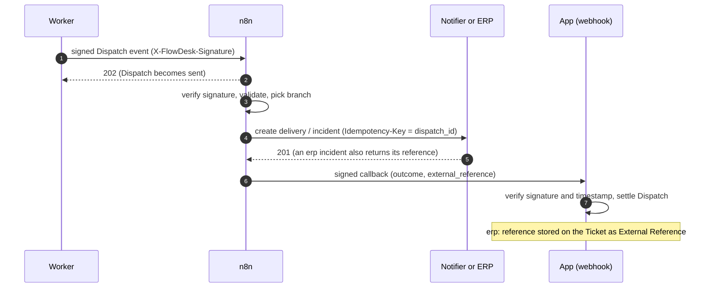
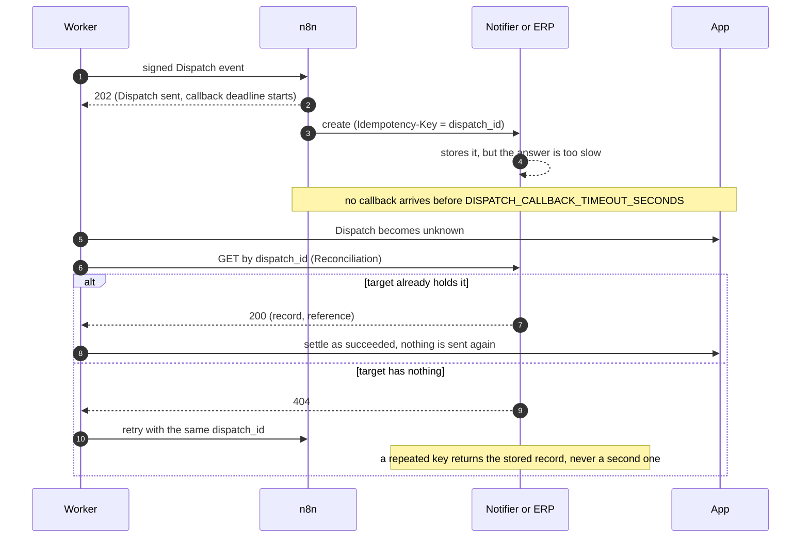

# FlowDesk AI

Turns internal business requests into structured, traceable Tickets. An AI reads each Request and extracts facts; deterministic rules decide Priority and Team; an n8n workflow delivers the notification; the app records every step so you can see what happened and why, including when an integration fails.

Terms (Request, Ticket, Dispatch, Route, …) are defined in [GLOSSARY.md](GLOSSARY.md).

**FlowDesk is not an ERP, and does not replace one.** It is the intake and orchestration layer in front of it: people describe a problem in plain language, FlowDesk turns it into a structured, prioritised, routed Ticket, and hands it to whatever system does the work. For an `erp` Ticket that system is the ERP, which stays the system of record; FlowDesk keeps the ERP's incident number as the Ticket's External Reference ([ADR 0009](docs/adr/0009-flowdesk-is-a-layer-in-front-of-the-erp.md)).

## Quick start

Requires Docker with Compose, and Node 24 + pnpm for `pnpm demo:e2e`. No API keys are needed: the default Classifier is a deterministic fake.

```sh
cp .env.example .env
docker compose up -d      # first start builds the image and imports the n8n workflow
pnpm install
pnpm demo:e2e             # Scenarios A–E against the live stack
```

- App: http://localhost:3000 (`GET /api/health` checks DB connectivity)
- n8n: http://localhost:5678 (executions of the dispatch workflow; create the owner account on first visit)
- Notifier: http://localhost:4000 (received-messages page)

Open the app and use **Sign in as…** on `/sign-in`: **Ana Morales** is a Requester only (she sees what she raised and can close or reopen her own Tickets); **Grace Lindqvist** (`it_systems`), **Ines Duarte** (`data_team`), **Kofi Mensah** (`it_systems` and `data_team`) and **Jonas Weber** (`service_desk`) belong to a Team and are Operators of its Tickets. Same password for all seeded Users; `DEMO_SIGN_IN=off` removes the shortcuts.

Host ports can be overridden in `.env` (`APP_HOST_PORT`, `N8N_HOST_PORT`, `NOTIFIER_HOST_PORT`, `POSTGRES_HOST_PORT`); `pnpm demo:e2e` reads them. `pnpm demo:e2e` also honours `E2E_APP_URL` and `E2E_NOTIFIER_URL`.

For a guided tour, follow the [demo script](docs/demo.md) (about 4 minutes). The HTTP API is documented in [docs/api.md](docs/api.md).

## Architecture

```
             ┌──────────────┐  POST /api/tickets (Idempotency-Key)
 Requester ─►│  Next.js app │──────────────┐
  (UI/API)   │  (UI + API)  │              ▼
             └──────┬───────┘      ┌──────────────┐
                    │ reads        │  PostgreSQL  │◄────────┐
                    ▼              │  app DB      │         │ claims jobs
             ┌──────────────┐      │  (+ n8n DB)  │  ┌──────┴──────┐
             │  Dashboard   │      └──────────────┘  │   Worker    │──► LLM (OpenAI-compatible)
             └──────────────┘              ▲         └──────┬──────┘
                                           │ callback       │ signed Dispatch event
                                           │ (HMAC)         ▼
                                    ┌──────┴───────────────────┐
                                    │           n8n            │
                                    │ verify → switch Team/    │
                                    │ Urgent Route → deliver   │
                                    └──────────────┬───────────┘
                                                   │ Idempotency-Key = dispatch_id
                                                   ▼
                                    ┌──────────────────────────┐
                                    │ Simulated notification   │
                                    │ service (failure modes)  │
                                    └──────────────────────────┘
```

| Compose service | Purpose |
| --- | --- |
| `postgres` | Databases `flowdesk` (app) and `n8n` |
| `migrate` | One-shot: migrations and idempotent demo data |
| `app` | Next.js UI, public API and the n8n callback webhook |
| `worker` | Claims jobs from a Postgres table: classify, dispatch, reconcile |
| `n8n`, `n8n-import` | Runs the dispatch workflow; the one-shot imports it on first start |
| `notifier` | Simulated notification target with failure modes |
| `erp` | Simulated ERP: `erp` Tickets become incidents; same failure modes ([ADR 0009](docs/adr/0009-flowdesk-is-a-layer-in-front-of-the-erp.md)) |

Code layout: `src/domain` (pure rules, no I/O), `src/services` (use cases, called by both Route Handlers and Server Actions), `src/infra` (database, Classifier, Workflow Engine client, HMAC), `src/worker`, `services/notifier`, `services/erp`, `n8n/workflows`. The full design is in [docs/plan/IMPLEMENTATION.md](docs/plan/IMPLEMENTATION.md).

## Design decisions

Recorded as ADRs in [docs/adr/](docs/adr/):

| ADR | Decision |
| --- | --- |
| [0001](docs/adr/0001-ai-extracts-facts-rules-decide.md) | AI extracts facts; deterministic rules decide Priority and Team |
| [0002](docs/adr/0002-long-running-local-first-deployment.md) | Local-first, long-running deployment via Docker Compose |
| [0003](docs/adr/0003-openai-compatible-llm-provider.md) | OpenAI-compatible LLM provider behind a Classifier interface |
| [0004](docs/adr/0004-background-processing-via-postgres-jobs.md) | Background processing via a Postgres job table and a worker |
| [0005](docs/adr/0005-app-decides-n8n-executes.md) | The app decides; n8n executes and reports back |
| [0006](docs/adr/0006-reconcile-before-retry.md) | Reconcile before retry; the worker is the only retry owner |
| [0007](docs/adr/0007-better-auth-and-per-ticket-capacities.md) | Better Auth sessions; Requester and Operator are per-Ticket capacities, not roles |
| [0008](docs/adr/0008-permission-from-team-assignment-is-accountability.md) | Permission comes from Team membership; assignment is accountability |
| [0009](docs/adr/0009-flowdesk-is-a-layer-in-front-of-the-erp.md) | FlowDesk is an intake and orchestration layer in front of the ERP, not a replacement |
| [0010](docs/adr/0010-invariants-live-in-code-not-prose.md) | Invariants live in code and checks, not in prose |
| [0011](docs/adr/0011-power-automate-as-alternative-workflow-engine.md) | Power Automate is an alternative Workflow Engine, chosen per deployment |

In short: a lost HTTP response is never treated as a failed operation. Each Dispatch has one id used as the idempotency key from the app through n8n to the notifier, so a retry cannot deliver twice, and an unconfirmed Dispatch is checked against the notifier before it is retried.

## How it was built

Most of the code was written by AI agents (Claude Code), directed and reviewed by a human, in a fixed loop:

1. **Plan and specs.** The idea and scope are in [docs/plan/PLAN.md](docs/plan/PLAN.md) and the design in [docs/plan/IMPLEMENTATION.md](docs/plan/IMPLEMENTATION.md). Each release has a spec in [docs/specs/](docs/specs/) that splits it into tasks, each with an "Accepted when" line.
2. **Jira.** Each task is a Story or Task in the Jira project `SCRUM`, grouped under an Epic per spec.
3. **One branch and one pull request per issue.** Decisions made along the way become ADRs, and new terms go into [GLOSSARY.md](GLOSSARY.md).
4. **CI on every pull request** ([.github/workflows/ci.yml](.github/workflows/ci.yml)): formatting, ESLint (including import boundaries between layers), typecheck, and the test suite against a real Postgres.
5. **Verification before merging.** The [verify skill](.claude/skills/verify/SKILL.md) rebuilds the stack, runs `pnpm demo:e2e`, and walks the issue's acceptance criteria in the browser as the Requester and the Operator.

Rules that matter are enforced by code shape, lint rules and tests rather than written instructions ([ADR 0010](docs/adr/0010-invariants-live-in-code-not-prose.md)). Agent configuration is in [CLAUDE.md](CLAUDE.md) and [docs/agents/](docs/agents/).

## Configuration

All settings live in `.env` (copy [.env.example](.env.example); it holds placeholders only).

| Variable | Purpose |
| --- | --- |
| `DATABASE_URL` | App database |
| `FLOWDESK_API_KEY` | Static key for the public API (`X-API-Key`) |
| `BETTER_AUTH_SECRET` | Secret that signs session cookies (Better Auth) |
| `BETTER_AUTH_URL` | Public base URL of the app, used by Better Auth |
| `DEMO_SIGN_IN` | `off` removes the "Sign in as…" shortcuts on `/sign-in` and makes their endpoint refuse; anything else keeps them |
| `CLASSIFIER` | `fake` (default) or `openai_compatible` |
| `LLM_BASE_URL`, `LLM_API_KEY`, `LLM_MODEL` | Required for `openai_compatible` |
| `FAKE_CLASSIFIER_MODE` | `valid`, `invalid`, `timeout`, `provider_error` |
| `WORKFLOW_ENGINE` | `n8n` (default) or `power_automate`: the Workflow Engine every Dispatch goes to ([ADR 0011](docs/adr/0011-power-automate-as-alternative-workflow-engine.md)) |
| `N8N_WEBHOOK_URL`, `FLOWDESK_CALLBACK_URL` | Where the worker sends events to n8n, and where the Workflow Engine calls back (default: the selected engine's route on `app`) |
| `POWER_AUTOMATE_TRIGGER_URL` | The flow's HTTP trigger URL; it carries the `sig` that authenticates the call, so keep it secret. Required for `power_automate` |
| `POWER_AUTOMATE_TO_FLOWDESK_SECRET` | Bearer secret Power Automate sends on `POST /api/webhooks/power-automate`. Required for `power_automate` |
| `FLOWDESK_TO_N8N_SECRET`, `N8N_TO_FLOWDESK_SECRET` | HMAC secrets for each direction |
| `NOTIFIER_URL` | Notifier base URL (Reconciliation) |
| `DISPATCH_CALLBACK_TIMEOUT_SECONDS` | Wait for the Workflow Engine's callback before a Dispatch becomes `unknown` |
| `TUNNEL_METRICS_HOST_PORT` | Loopback port of the tunnel's metrics, read by `pnpm tunnel:url` (default `2000`) |

Change the `change-me` values before exposing the stack anywhere.

## The e2e check

`pnpm demo:e2e` ([scripts/demo-e2e.ts](scripts/demo-e2e.ts)) drives the four acceptance scenarios from [PLAN.md §8](docs/plan/PLAN.md) plus Scenario E through the public API, session cookies and the notifier and ERP admin endpoints, using the real n8n:

- **A**: SAP Request → classified, urgent by `erp_blocker` → Dispatch succeeded, `[URGENT]` message delivered; a repeated Idempotency-Key yields the same Ticket.
- **B**: company-wide blocker → urgent by `org_wide_blocker`, evaluation recorded.
- **C**: notifier set to `fail` → Dispatch `failed`, Ticket intact → mode `ok`, manual retry → same Dispatch, new attempt, earlier attempts kept, one Ticket.
- **D**: worker swapped for a one-off container with `FAKE_CLASSIFIER_MODE=invalid` → repair fails → `needs_review`, raw output kept, no Dispatch → manual classification dispatches. The compose worker is restored afterwards. `E2E_SKIP_D=1` skips this scenario.
- **E**: the two-User path. Ana (a Requester) raises a Ticket; Kofi (Operator of its Team) takes and resolves it; Ana has an unread Notification and closes the Ticket with a reason; neither of them can do the other's action, and the timeline shows the reason.

It adds Tickets to the running stack and takes about two minutes (Scenario C waits out the automatic retries). To run it without touching your own data, start a separate stack: `COMPOSE_PROJECT_NAME=flowdesk-e2e docker compose up -d` with different host ports in `.env`, then run the script from the same directory with the same `COMPOSE_PROJECT_NAME` exported (Scenario D drives `docker compose` and needs to reach that stack). Both stacks share the `flowdesk-app` image tag, so rebuilding one retags it for the other.

## Simulated notifier

`services/notifier` stands in for the external notification target. Deliveries are stored in a JSON file on the `notifier-data` volume.

- `POST /deliveries` with an `Idempotency-Key` header and `{ "channel", "message" }`: `201` on first receipt; a repeated key returns the stored delivery with `200` and no new effect.
- `GET /deliveries/:id`: `200` or `404` (used by Reconciliation).
- `GET /`: HTML list of received messages.
- `POST /admin/mode` with `{ "mode": "…" }` (`GET` shows the current mode). The mode is not persisted, so a restart puts it back to `ok`. It applies to new keys only; a repeated key always gets its stored delivery.

| Mode | Effect on a new delivery |
|------|--------------------------|
| `ok` | stored, `201` |
| `fail` | not stored, `500` |
| `fail_once` | not stored, `500`, then back to `ok` |
| `timeout` | not stored, held past n8n's 10s timeout, then `504` |
| `accept_then_drop_callback` | stored, but the `201` comes only after n8n's timeout: the lost-response case |

Slow modes hold the request for `SLOW_RESPONSE_MS` (default 15000).

```sh
curl -X POST localhost:4000/admin/mode -H 'content-type: application/json' -d '{"mode":"fail_once"}'
```

## Simulated ERP

`services/erp` stands in for the ERP an `erp` Ticket is handed to. FlowDesk does not replace it: the ERP stays the system of record, and FlowDesk keeps its incident number as the Ticket's External Reference ([ADR 0009](docs/adr/0009-flowdesk-is-a-layer-in-front-of-the-erp.md)). Incidents are stored in a JSON file on the `erp-data` volume.

- `POST /incidents` with an `Idempotency-Key` header and `{ "ticket_number", "title", "summary", "priority" }`: `201` with the incident and its `reference` (`INC-000001`, …); a repeated key returns the stored incident with `200` and creates nothing.
- `GET /incidents/:id`: `200` with the incident or `404` (used by Reconciliation, which also takes the `reference` from it).
- `GET /`: HTML list of incidents.
- `POST /admin/mode`: the same modes as the notifier, on `localhost:4100`.

To use a real ERP, only the workflow's `Create ERP incident` node changes: call the ERP's API (for SAP, an OData service) with the `dispatch_id` as its idempotency key, and return its record id as `external_reference`. Reconciliation then needs that system's lookup by the same key in `src/infra/erp/client.ts`.

## Public tunnel (optional, for a cloud Workflow Engine)

Power Automate runs in the cloud and cannot reach the compose network (ADR 0011). The `power-automate` profile adds a [Caddy](docker/tunnel/Caddyfile) proxy behind a `cloudflared` quick tunnel (no Cloudflare account):

```sh
docker compose --profile power-automate up -d
pnpm tunnel:url               # writes FLOWDESK_CALLBACK_URL=https://<random>.trycloudflare.com/callback to .env
docker compose up -d worker   # picks up the new value
```

Only the routes the flow calls answer through the public URL: `POST /callback` (the Power Automate callback, `/api/webhooks/power-automate`), `GET /notifier/deliveries/<id>`, `POST /notifier/deliveries` and `POST /erp/incidents`. The web UI, the API, n8n, Postgres and the notifier and ERP admin endpoints stay private. The flow derives the notifier and ERP URLs from the origin of `callback_url` in each event, so a new tunnel URL needs no change to the flow. A quick tunnel gets a new URL on every restart: run `pnpm tunnel:url` again. Without the profile, `docker compose up` is unchanged.

`FLOWDESK_CALLBACK_URL` is also where n8n calls back, so only run `pnpm tunnel:url` when the stack dispatches to Power Automate; to go back to n8n, restore `FLOWDESK_CALLBACK_URL=http://app:3000/api/webhooks/n8n`.

## n8n workflows

There is one workflow, `n8n/workflows/flowdesk-dispatch.json`. n8n only executes: the app has already decided Category, Team, Priority and Route, and the workflow never decides or retries ([ADR 0005](docs/adr/0005-app-decides-n8n-executes.md)). The diagrams below render on GitHub.

### Workflow: `flowdesk-dispatch`



A failing HTTP node does not stop the workflow: `Build callback` reports the failure to the app, which owns retries.

### Dispatch: app, n8n and target



### Lost response: Reconcile before retry



## Dispatch

A classified, dispatchable Ticket gets a Dispatch, which the worker sends to n8n (`N8N_WEBHOOK_URL`) as an HMAC-signed event: `X-FlowDesk-Signature: sha256=HMAC(FLOWDESK_TO_N8N_SECRET, timestamp + "." + body)` with `X-FlowDesk-Timestamp`. n8n answers `202`, the Dispatch becomes `sent`, and it has `DISPATCH_CALLBACK_TIMEOUT_SECONDS` to report back. A non-2xx answer or a network error is a failed attempt; after 3 the Dispatch is `failed`.

The workflow `n8n/workflows/flowdesk-dispatch.json` verifies the signature, validates the event, and then takes one of two branches. An `erp` Dispatch creates an incident in the simulated ERP; every other Category picks the Team's channel, prefixes `[URGENT]` on the Urgent Route and delivers to the notifier. Both send `Idempotency-Key = dispatch_id` (no retries in n8n). It then calls `POST /api/webhooks/n8n` (`FLOWDESK_CALLBACK_URL`), signed the same way with `N8N_TO_FLOWDESK_SECRET`; for an `erp` Dispatch the callback carries the incident's `external_reference`, stored on the Ticket. The callback is rejected with `401` on a bad signature or a timestamp more than 5 minutes off; a callback for an already-settled Dispatch is recorded on the timeline and changes nothing.

`n8n-import` imports and publishes the workflow on n8n's first start only. To load an edited workflow into an existing stack:

```sh
docker compose stop n8n
docker compose run --rm --entrypoint rm n8n-import -f /home/node/.n8n/.flowdesk-workflows-imported
docker compose run --rm n8n-import && docker compose up -d n8n
```

## Classification

The worker classifies each Ticket with the Classifier chosen by `CLASSIFIER`:

- `fake` (default): deterministic and key-less. `FAKE_CLASSIFIER_MODE` is `valid` (keyword rules for the example Requests), `invalid`, `timeout` or `provider_error`, to exercise the failure paths.
- `openai_compatible`: any OpenAI-compatible chat completions API. Set `LLM_BASE_URL` (including `/v1`), `LLM_API_KEY` and `LLM_MODEL`. It asks for `json_schema`, falls back to `json_object`, then to plain JSON; the reply is always Zod-validated.

Invalid output gets one repair call, then the Ticket goes to `needs_review`. Provider errors get 3 attempts in total (waiting 2s, then 8s between them), then `needs_review`. Neither creates a Dispatch.

### Smoke test against the real provider

```sh
# .env: CLASSIFIER=openai_compatible, LLM_BASE_URL, LLM_API_KEY, LLM_MODEL
docker compose up -d --build worker app
curl -s -X POST localhost:3000/api/tickets \
  -H "X-API-Key: $FLOWDESK_API_KEY" \
  -H "Idempotency-Key: smoke-1" -H "Content-Type: application/json" \
  -d '{"requesterId":"<id from GET /api/requesters>","title":"SAP unreachable","description":"I haven'"'"'t been able to access SAP since this morning, and I need to process some invoices."}'
docker compose exec postgres psql -U flowdesk flowdesk -c \
  "select kind, outcome, model, error from classification_attempts order by created_at desc limit 3"
```

Expect `classified`, category `erp`, priority `urgent` (rule `erp_blocker`) on the Ticket. The `response_format` the provider accepts is not verified yet (it needs credentials): check which attempt succeeded in the worker logs and record it here.

## Development

```sh
pnpm install
docker compose up -d postgres   # tests run against the flowdesk_test database
pnpm test
pnpm typecheck && pnpm lint
```

The compose `migrate` step applies migrations and loads idempotent demo data (`pnpm db:migrate && pnpm db:seed`). After changing `src/infra/db/schema.ts`, run `pnpm db:generate` to add a migration. The test run drops and re-migrates `flowdesk_test` from scratch.

The Vitest suite runs against real Postgres. It covers the Priority Rules, status transitions, Classification schema, ticket creation and idempotency, Scenarios A–D (with a local stub in place of n8n), Reconciliation of a lost response, webhook signatures and worker job claiming. `pnpm demo:e2e` is the counterpart that exercises the real n8n.

## Limitations

- Authentication is Better Auth with seeded fictional Users (fixed demo password); the public API uses a static key. No sign-up, no password reset.
- No admin role or screen: Users, Teams and membership come from the seed. Operator rights come from Team membership (ADR 0008).
- No automatic assignment: an Operator takes a Ticket from the Team queue, or reassigns it. Assignment to individuals is manual.
- Notifications are in-app only (the header bell); nothing is sent by email or chat to a person.
- Reconciliation depends on the target exposing a lookup by idempotency key. The simulated notifier and ERP do; a real system may not.
- The ERP is simulated; there is no SAP connector (ADR 0009). An `erp` Ticket creates an ERP incident instead of a chat message to `it_systems`.
- A single worker process is assumed for the demo, though job claiming is safe for several.
- No semantic duplicate detection: two people reporting the same outage get two Tickets.
- The AI's self-reported reasoning is shown for explanation only and is never used for decisions.
- Scenario D in `pnpm demo:e2e` covers invalid output; provider errors (three attempts, then review) are covered by the Vitest suite, not the live check.
- The `response_format` accepted by a real LLM provider is not verified yet (see the smoke test above).

## Future improvements

Semantic duplicate linking, real SSO, an SAP/ERP connector, a Data Warehouse export of Ticket Events, SLA timers, assignment of Tickets to individuals within a Team, and real chat channels (Slack/Teams) as additional n8n branches.
